<div align="center">

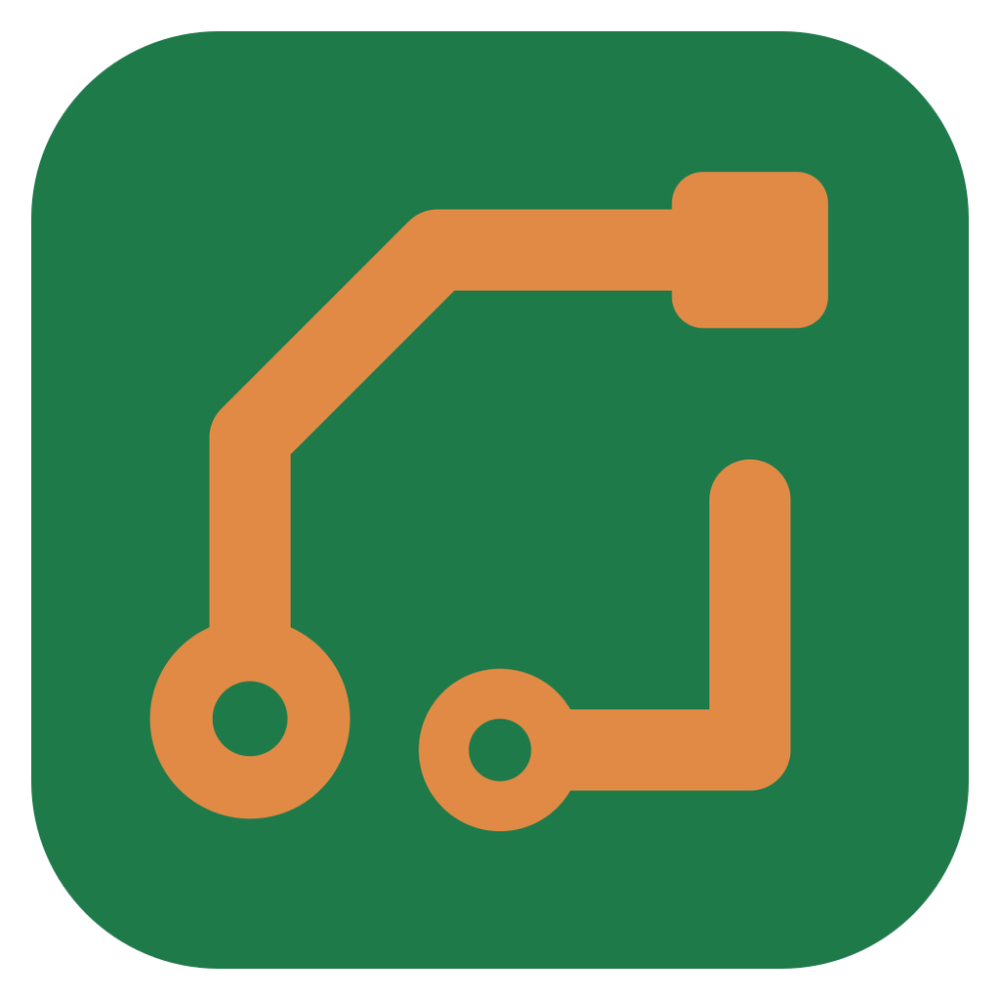

# Схемотехника с нуля

**Учебник электроники для начинающих по плану «Искусства схемотехники» Хоровица и Хилла: 109 уроков, живые схемы, задачи с проверкой и калькуляторы. Сайт и Android-приложение, работает без интернета.**


<br>

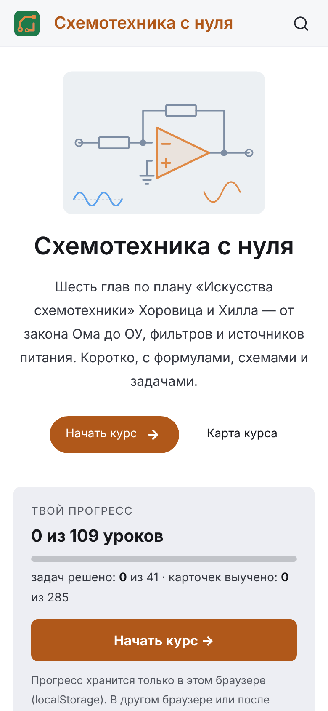
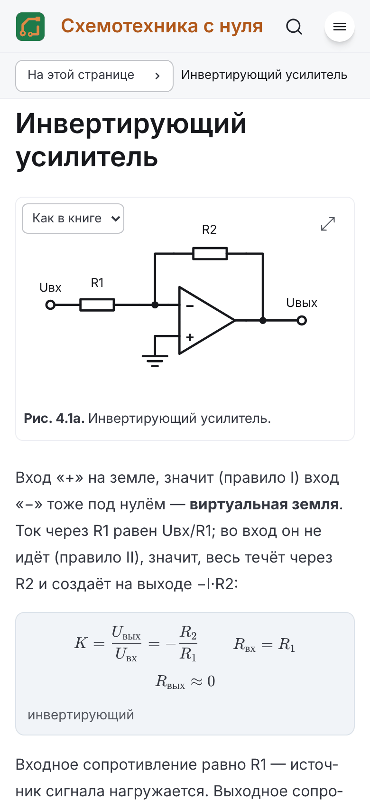
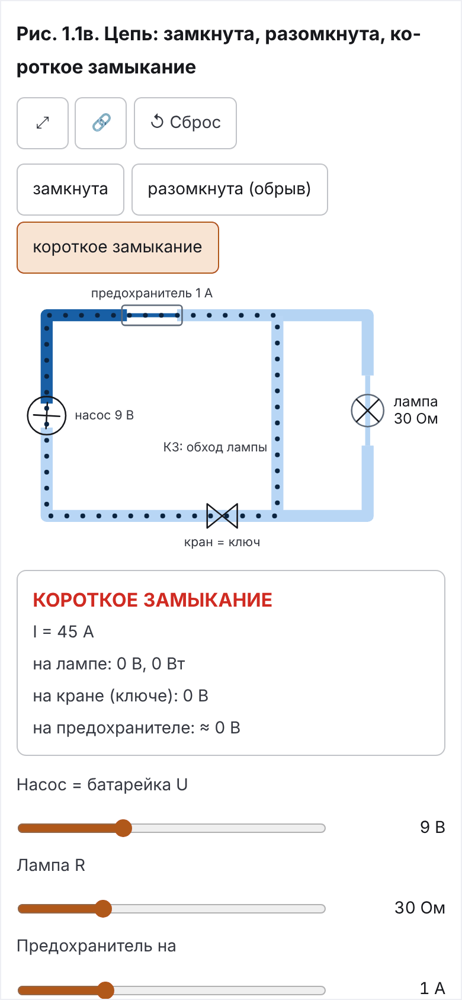
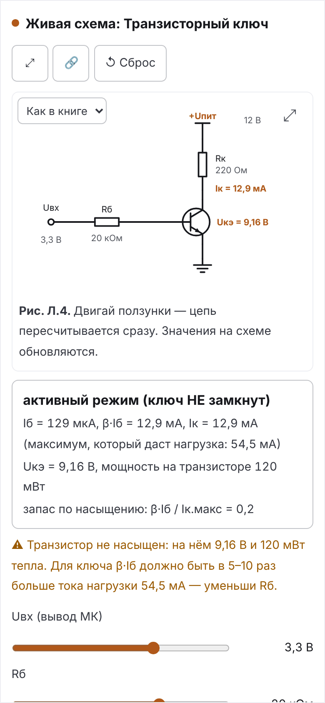
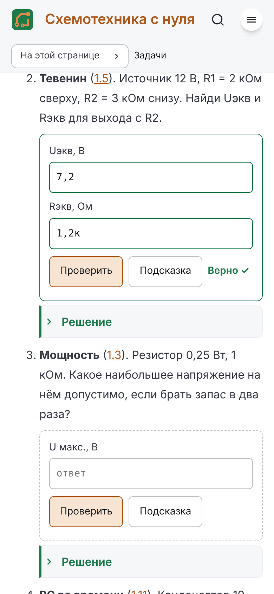

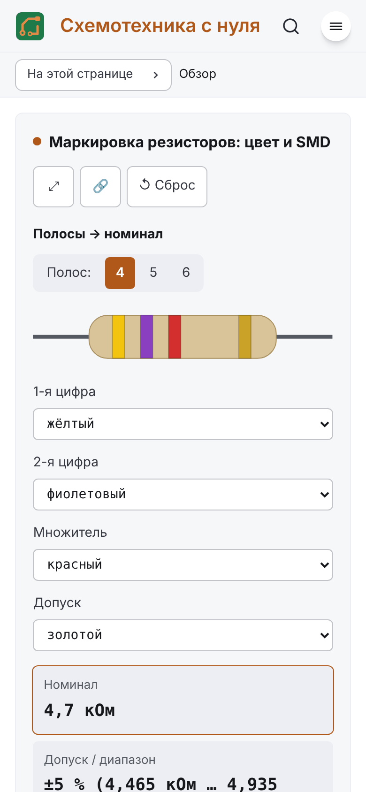
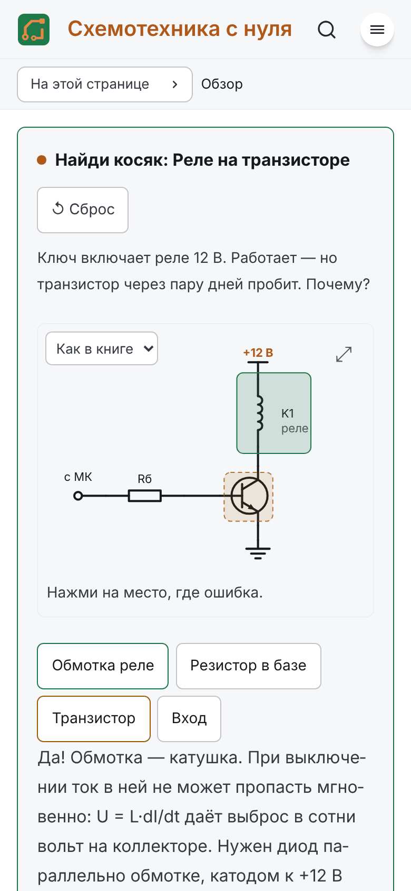
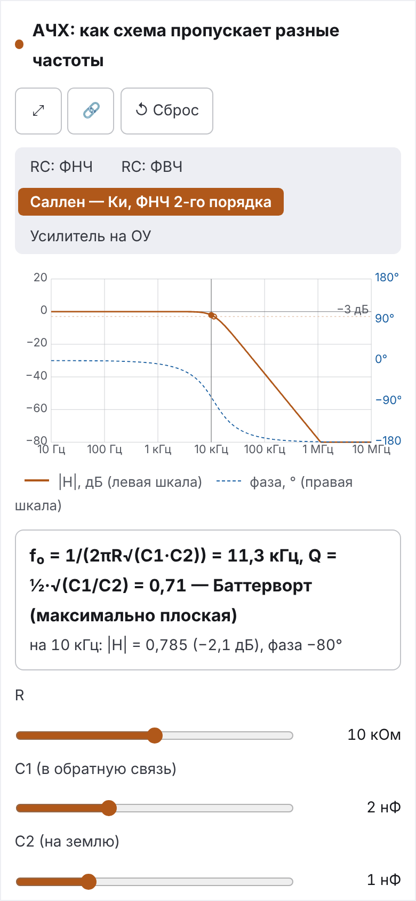
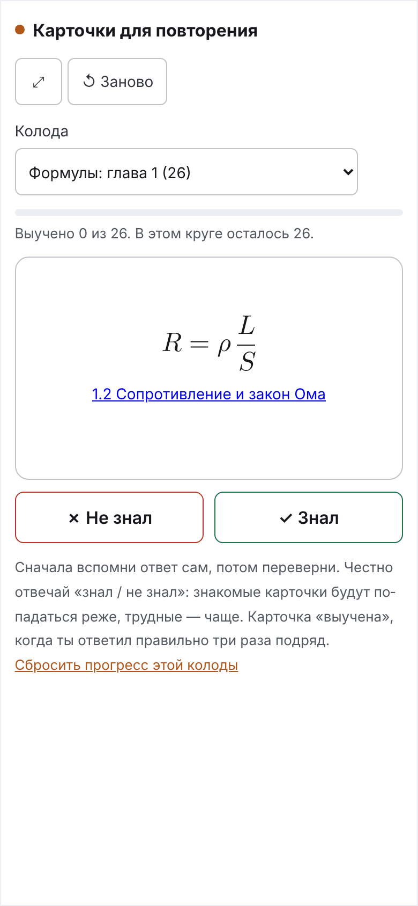
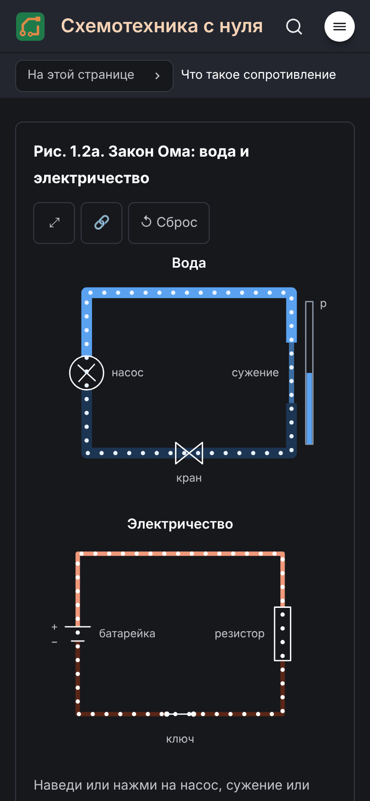

</div>

---

## Что это

Курс ведёт от закона Ома до операционных усилителей, фильтров и источников питания. Главы 1–6 повторяют главы первого тома «Искусства схемотехники». Дальше идут практикум и печатные платы, вплоть до ВЧ и СВЧ.

Каждый урок построен одинаково: коротко объяснить, показать на схеме или анимации, дать потрогать и проверить задачей. Схемы считаются по-настоящему: на живой схеме видно и 0,6 В на переходе, и насыщение ключа, и упор ОУ в питание.

## Возможности

| | |
|---|---|
| 📚 **Курс** | 6 глав по книге + 5 модулей: практикум, печатные платы, производство, ВЧ/СВЧ; у каждого урока ссылка на главу и страницу книги |
| 💧 **Водяные аналогии** | 11 анимаций с ползунками: ток, Ом, Кирхгоф, делитель, конденсатор, катушка, переменный ток, диод, p-n-переход, транзистор, развязка питания |
| ⚡ **Живые схемы** | 8 схем, которые пересчитываются на лету: делитель, светодиод, стабилитрон, ключ, повторитель, каскад с ОЭ, два усилителя на ОУ |
| ✅ **Задачи** | 41 задача с проверкой ответа (понимает «4,7к», «20м»), подсказки по шагам, решения; в уроках ответы спрятаны под кнопку |
| 🧮 **Калькуляторы** | 14 штук: Ом, делитель, ряды E6–E96, маркировка, светодиод, стабилитрон, LM317, радиатор, 555, мультивибратор, дорожка, микрополоска |
| 🔬 **Лаборатория** | АЧХ, тренажёр «Найди косяк», 285 карточек, шпаргалки глав, 4 лабы на Arduino/ESP32 с полным кодом |
| 📐 **Обозначения** | все схемы рисуются кодом и переключаются: как в книге / ГОСТ / IEC / ANSI |
| 🔗 **Опыты** | у каждого виджета — на весь экран, ссылка на текущее состояние и «Сброс» |
| 📴 **Офлайн и печать** | «Сохранить курс на устройство» (≈ 18 МБ); шпаргалки и главы целиком — в PDF |
| 📈 **Прогресс** | пройденные уроки, решённые задачи и выученные карточки — в браузере, без регистрации |

## Курс

| | Глава / модуль | Уроков |
|---|---|:-:|
| 1 | Основы электроники: Ом, Кирхгоф, RC, импеданс, диоды | 20 |
| 2 | Транзисторы: ключ, повторитель, Эберс — Молл, каскады | 10 |
| 3 | Полевые транзисторы | 5 |
| 4 | Обратная связь и ОУ | 13 |
| 5 | Активные фильтры и генераторы | 7 |
| 6 | Стабилизаторы и источники питания | 8 |
| 7–11 | Практикум · печатная плата · проектирование · производство · ВЧ/СВЧ | 43 |

## Что нового в 1.0

- **Калькуляторы — отдельным разделом.** Семь новых: ряды E6–E96 с подбором пары, маркировка (полосы и SMD в обе стороны), светодиод, стабилитрон, LM317, радиатор, 555.
- **Живые схемы.** В браузере работает решатель цепей (метод узловых потенциалов, Ньютон), а диоды и транзисторы считаются по экспоненциальным моделям.
- **Задачи с проверкой и спрятанные ответы.** Это 41 задача в упражнениях и 170 вопросов в уроках.
- **Лаборатория**: АЧХ, «Найди косяк», карточки с интервальным повторением, шпаргалки, лабы на железе.
- **Опыты**: ползунки во всех анимациях, «Сброс», полный экран, ссылка на состояние, подсветка «вода ↔ схема».
- **Стиль обозначений** ГОСТ / IEC / ANSI, **офлайн-режим**, **печать главы целиком**.

---

## Для разработчиков

### Архитектура

Статический сайт на Astro + Starlight. Всё интерактивное — это custom elements без фреймворков. Формулы рендерит KaTeX при сборке, поиск — Pagefind.

| Слой | Где | За что отвечает |
|---|---|---|
| Уроки | `src/content/docs/` | MDX: `m00…m11` — модули, `calc/`, `lab/`, `appendix/` |
| Схемы | `components/diagrams/` | `sch.ts` — символы (с вариантами ГОСТ/IEC/ANSI), `circuits.ts` — реестр схем |
| Живые схемы | `lib/mna.ts`, `diagrams/live.ts` | решатель цепей; схема + расчёт для каждой живой схемы |
| Виджеты | `components/interactive/` | калькуляторы, `LiveCircuit`, `BodePlot`, `FindBug`, `Flashcards`, `Quiz` |
| Водяные аналогии | `components/water/`, `lib/water.ts` | анимации и мини-движок; `WaterFrame` — рамка и шаблон для сброса |
| Общее поведение | `lib/reset.ts`, `lib/sym.ts` | кнопки ⤢ / 🔗 / Сброс, ссылки на состояние; стиль обозначений |
| Уроки: компоненты | `components/lesson/` | `Formula`, `M`, `Callout`, `Mistakes`, `Check`, `Reveal` |
| Офлайн и печать | `public/sw.js`, `pages/print/`, `scripts/postbuild.mjs` | service worker, глава целиком, список файлов для офлайна |
| Приложение | `android/`, `capacitor.config.ts` | Capacitor-оболочка с копией сайта внутри |

### Сборка

Нужен **Node.js 22.23+**.

```bash
npm install
npm run dev              # http://localhost:4321
npm run build            # dist/ + постобработка
npm run build:android    # сборка для приложения → android/
```

### Проверки

```bash
npm run check            # сборка, все внутренние ссылки, тесты решателя и единиц
npm run check:ui         # Chromium: вёрстка 360/768/1024/1440, ошибки JS, ключевые виджеты
```

Перед `check:ui` один раз выполни `npx playwright install chromium` или укажи свой браузер: `CHROME_PATH=/usr/bin/google-chrome`.

### Новый урок

```yaml
---
title: Инвертирующий усилитель
sidebar: { label: "4.1 Основные схемы включения ОУ", order: 1 }
duration: 35
goals: [вывести усиление из золотых правил]
book: [{ ch: 4, sec: "4.04", page: 184 }]
---
```

| Компонент | Пример |
|---|---|
| Формула | `<Formula tex="K = -\frac{R_2}{R_1}" />`, в строке — `<M t="r_e = 25\,\text{мВ}/I_К" />` |
| Схема | `<Circuit id="oa-inverting" n="4.1" caption="…" />` |
| Живая схема | `<LiveCircuit id="divider" />` |
| Задача | `<Check a={[{ label: "Uвых", unit: "В", value: "3,33" }]} hint="…" />` |
| Спрятанный ответ | `Вопрос? <Reveal>ответ</Reveal>` |

Ссылки между уроками — относительные: `[1.2](../../m01-basics/02-ohms-law/)`. После правки формул запусти `npm run sheets`: он пересоберёт шпаргалки и карточки.

### Публикация

- **GitHub Pages.** Settings › Pages › Source: *GitHub Actions*. Workflow `deploy.yml` сам подставляет адрес.
- **Netlify.** Настройки берутся из `netlify.toml`.
- **Под подпапку:** `SITE_URL=https://user.github.io BASE_PATH=/pcb-course npm run build`.

### Android

- **APK без Android Studio.** Workflow `android.yml`, дальше Actions › Build Android APK › Artifacts.
- **Локально** нужны JDK 21 и Android SDK 36: `npm run build:android && npm run open:android`.
- **После правки уроков** снова запусти `build:android`: приложение возит с собой копию сайта.
- **Публичный адрес.** Чтобы «поделиться» работало из приложения, собирай с `SITE_URL=<адрес сайта>`.
- **Google Play.** Нужен свой `appId` (`capacitor.config.ts`, `app/build.gradle`) до первой публикации и подписанный `.aab`. Ключ сохрани.

### Версии

Astro 7, Starlight 0.42, KaTeX 0.16, Capacitor 8; Android: compileSdk/targetSdk 36, minSdk 24; Node 22.23+.

### Источники

П. Хоровиц, У. Хилл. *Искусство схемотехники*, т. 1 (М.: Мир, 1993) — главы 1–6 · Л. Г. Малорацкий. *Микроминиатюризация элементов и устройств СВЧ* (1976) — модуль 11 · даташиты производителей, IPC-2221B / 2152 / 7351B / A-600 / A-610, ЕСКД.
